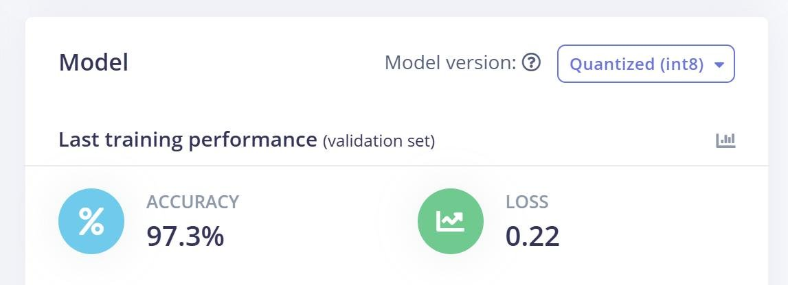
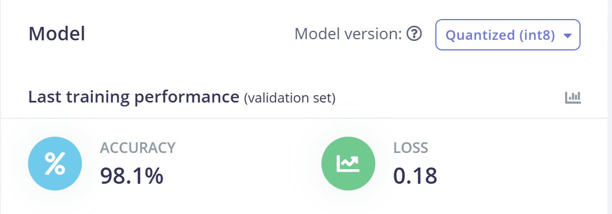
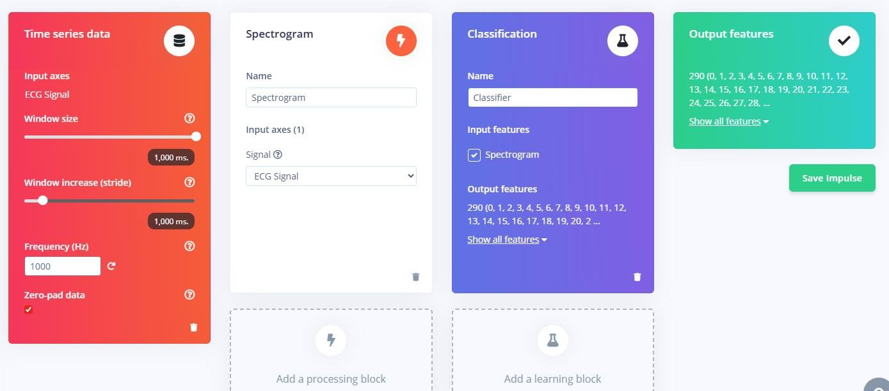
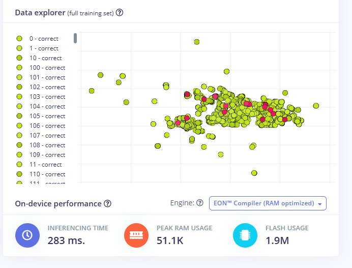
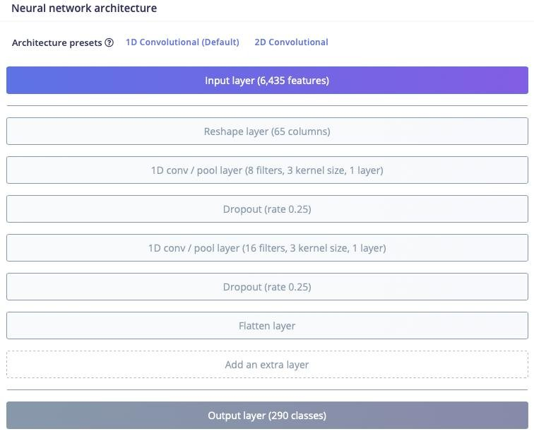
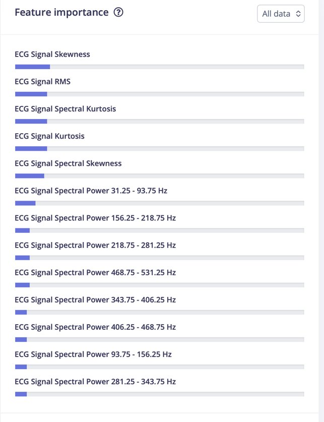

# ❤️ HeartPrint — ECG Biometric Identification on Microcontrollers (TinyML)

> **Your heartbeat as a fingerprint: ECG biometric classification squeezed onto an MCU.**


Biometric **ECG signal classification** (290 subject classes) built in **Edge Impulse** and profiled for the **Espressif ESP-EYE (ESP32)**. The project compares two pre-processing approaches and three network architectures, each in **quantized int8** and **unoptimized float32** form, by accuracy, latency, RAM and flash.

- **Part 1** – Spectral Features (FFT) + 2-layer DNN (20 / 30 / 60 neurons)
- **Part 2** – Spectrogram + DNN, **1-D CNN** and **2-D CNN**

## Results

| Parameter | DNN int8 | DNN float32 | **1D CNN int8** | 1D CNN float32 | 2D CNN int8 | 2D CNN float32 |
|---|---|---|---|---|---|---|
| Flash | 413.1 K | 1.6 M | **145.6 K** | 483.8 K | 1.9 M | 7.5 M |
| Accuracy | 95.91 % | 96.25 % | **98.43 %** | 98.60 % | 98.64 % | 98.67 % |

Best performance-to-cost ratio: **Spectrogram + 1-D CNN + quantized int8** – almost the accuracy of the 2-D CNN at ~1/13 of its flash. Spectral features + DNN alone (Part 1) reached only 24 % (int8) – 65.5 % (float32) validation accuracy, showing how much richer time-frequency (spectrogram) features are for ECG.

| Spectrogram + DNN | Spectrogram + 1D CNN | Spectrogram + 2D CNN |
|---|---|---|
|  |  |  |

## Tools

- **Edge Impulse Studio / CLI**, Node.js ≥ 14, Python 3, git
- Dataset: [`Yogeshwar/TinyML_ECG_Data`](https://huggingface.co/datasets/Yogeshwar/TinyML_ECG_Data) (Hugging Face)
- Target device for profiling: **Espressif ESP-EYE (ESP32)**

## ML Pipelines

| | Part 1 | Part 2 |
|---|---|---|
| Input | Time series @ **1000 Hz**, window = stride = 1000 ms | same |
| Pre-processing | **Spectral Features** (FFT, length 16, log spectrum, overlap) | **Spectrogram** (frame 0.02 s, stride 0.01 s, FFT 128, noise floor −52 dB) |
| Learning block | DNN, 2 dense layers (20/30/60 neurons) | DNN (2×60), **1D CNN** (8/16 filters, k=3), **2D CNN** |
| Learning rate | 0.0005 | 0.0005 |
| Output | 290 classes | 290 classes |

## Reproduce

```bash
npm install -g edge-impulse-cli --force
./scripts/upload_ecg_dataset.sh       # clone + upload the ECG dataset
```

1. Create a project, upload the training/testing data.
2. **Part 1:** Time series (1000 Hz, 1000 ms) → Spectral Features → Classification (2-layer DNN). Try 20/30/60 neurons, check Feature Importance.
3. **Part 2:** Time series → Spectrogram → Classification with DNN, 1D CNN, 2D CNN.
4. For each model, switch between *Quantized (int8)* and *Unoptimized (float32)* and record latency / RAM / flash / accuracy for ESP32.
5. In model testing, move only a *few* misclassified samples into training to avoid overfitting.

## Gallery

| Spectrogram impulse | Feature explorer | 1D CNN architecture | Feature importance (Part 1) |
|---|---|---|---|
|  |  |  |  |


## Concepts Covered

- Spectral features vs. spectrograms for physiological signals
- DNN vs. 1D CNN vs. 2D CNN accuracy/resource trade-offs
- Quantization (int8) vs. float32: ~4× smaller memory for a small accuracy cost
- ECG as a biometric: universality, uniqueness, liveness detection

## Author

- **Aryan Verma**

